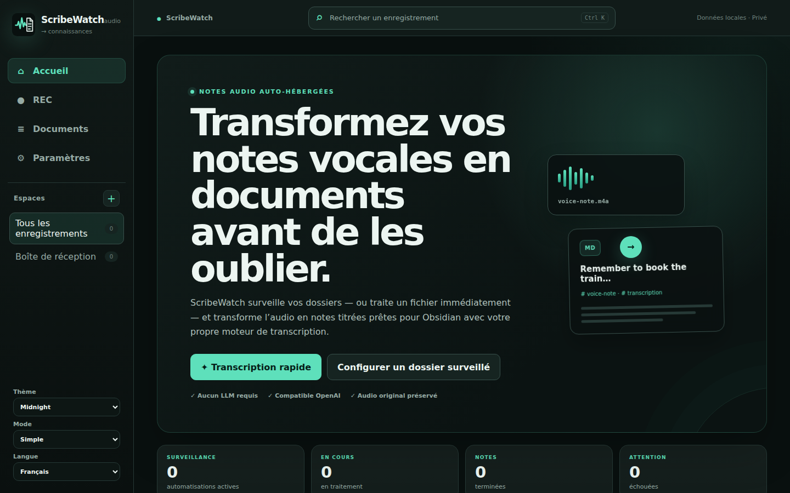
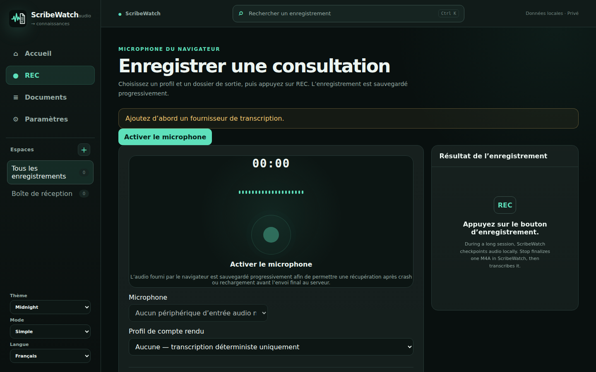
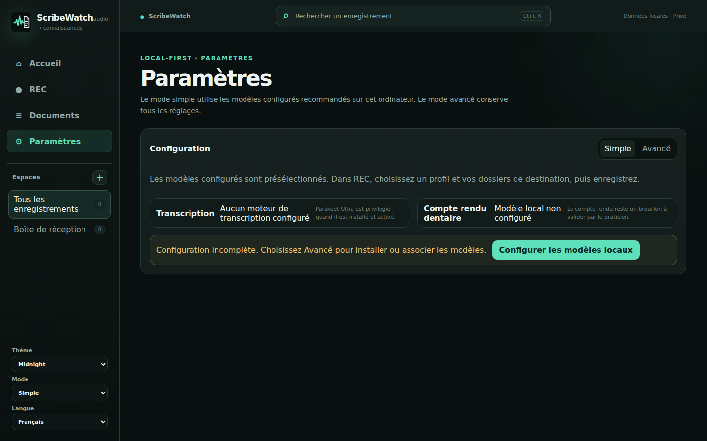
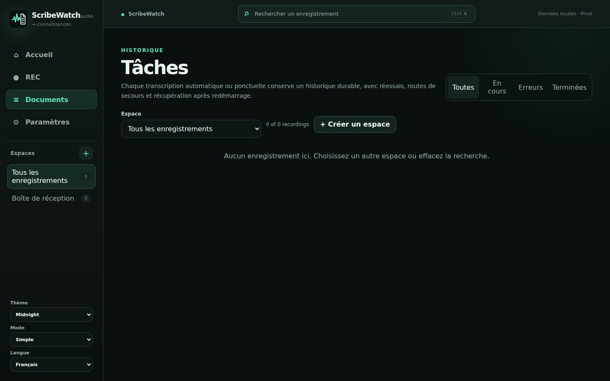
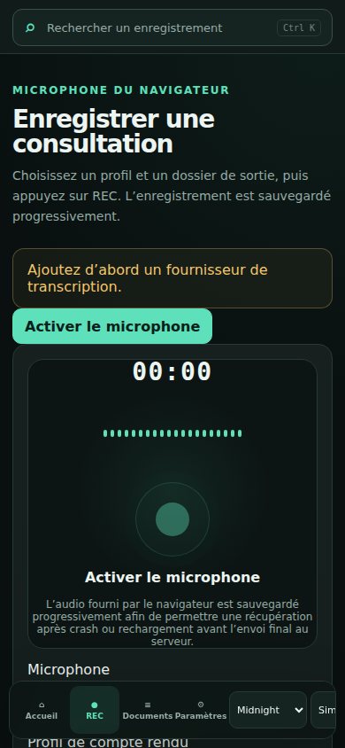

<p align="center">
  
</p>

<h1 align="center">ScribeWatch</h1>

<p align="center">
  <strong>Enregistrez. Transcrivez. Structurez. Gardez le contrôle.</strong><br>
  Enregistrements, transcriptions et documents structurés en local, sur Windows, macOS, Linux ou Docker.
</p>

<p align="center">
  <a href="https://github.com/GodsQuantum/ScribeWatch/actions/workflows/ci.yml"></a>
  <a href="LICENSE"></a>
  
  
  
  
</p>

<p align="center">🇬🇧 <a href="README.md">English README</a> · <a href="README.zh-CN.md">简体中文</a></p>

---

ScribeWatch transforme vos enregistrements en **notes Markdown propres et titrées** avec votre propre moteur speech-to-text compatible OpenAI. Déposez une note vocale dans **Quick Transcribe**, enregistrez directement dans **Live Recorder**, ou pointez un **Workflow** vers un dossier et laissez ScribeWatch traiter automatiquement les nouveaux audios.

Le transcript reste canonique et déterministe. Pour les usages qui demandent davantage de structure, un LLM compatible OpenAI peut ajouter après transcription une vue structurée réutilisable — réunion, consultation, brainstorm ou profil personnalisé — **sans jamais remplacer le transcript original**.

Le cas d’usage naturel est **notes vocales → Obsidian**, mais rien n’est verrouillé à Obsidian : n’importe quel dossier Markdown fonctionne.

<p align="center">
  
</p>

## Télécharger ScribeWatch v0.6.4

**[Site officiel](https://scribewatch.arezkichougar.com/)** · **[Dernière release GitHub](https://github.com/GodsQuantum/ScribeWatch/releases/latest)** · [Empreintes SHA-256](https://github.com/GodsQuantum/ScribeWatch/releases/tag/v0.6.4) · [Code source](https://github.com/GodsQuantum/ScribeWatch)

**Choisissez la version complète pour commencer.** Elle contient les moteurs de transcription et de rédaction locale. Les modèles sont téléchargés au premier lancement ; ensuite, ces traitements locaux ne nécessitent pas d'envoyer les enregistrements ou les textes à un serveur distant.

| Système | Version locale complète | Installateur |
|---|---|---|
| **Windows 11 x64** | Recommandée | [Installateur Windows complet](https://github.com/GodsQuantum/ScribeWatch/releases/download/v0.6.4/ScribeWatch-0.6.4-windows-amd64-standalone-setup.exe) |
| macOS Apple Silicon | IA locale incluse | [DMG Apple Silicon](https://github.com/GodsQuantum/ScribeWatch/releases/download/v0.6.4/ScribeWatch-0.6.4-darwin-arm64-standalone.dmg) |
| macOS Intel | IA locale incluse | [DMG Intel](https://github.com/GodsQuantum/ScribeWatch/releases/download/v0.6.4/ScribeWatch-0.6.4-darwin-amd64-standalone.dmg) |
| Linux x86-64 | IA locale incluse | [AppImage complète](https://github.com/GodsQuantum/ScribeWatch/releases/download/v0.6.4/ScribeWatch-0.6.4-x86_64-standalone.AppImage) · [Debian/Ubuntu .deb](https://github.com/GodsQuantum/ScribeWatch/releases/download/v0.6.4/scribewatch_0.6.4_amd64.deb) |
| Linux ARM64 | IA locale incluse | [AppImage complète](https://github.com/GodsQuantum/ScribeWatch/releases/download/v0.6.4/ScribeWatch-0.6.4-aarch64-standalone.AppImage) · [Debian/Ubuntu .deb](https://github.com/GodsQuantum/ScribeWatch/releases/download/v0.6.4/scribewatch_0.6.4_arm64.deb) |

**Première utilisation :** installez ScribeWatch, laissez les modèles se télécharger une fois (plusieurs gigaoctets), choisissez un type de note, enregistrez ou importez un audio, puis exportez en PDF, Word, ODT, HTML, TXT ou Markdown. Les versions complètes embarquent Pandoc 3.14, Typst 0.15.1 et les polices nécessaires ; inutile de les installer séparément. Un processeur 64 bits récent suffit pour démarrer, mais une carte graphique compatible accélère les traitements ; **16 Go de RAM sont conseillés pour les comptes rendus structurés**, sans constituer un minimum certifié.

**Pour utilisateurs avancés :** des versions légères Windows/macOS/Linux existent dans les [releases GitHub](https://github.com/GodsQuantum/ScribeWatch/releases/tag/v0.6.4). Elles **n'installent pas de moteur local de transcription ou de rédaction**. Elles s'adressent à ceux qui disposent déjà de services STT/LLM compatibles.

Les installateurs complets et leurs moteurs passent la CI multi-OS, mais les microphones physiques, tous les GPU et la qualité des rapports cliniques ne sont **pas certifiés sur chaque ordinateur**. Les brouillons médicaux doivent être relus par le praticien. Si vous choisissez un fournisseur externe, ses règles de confidentialité s'appliquent. Les binaires peuvent être non signés ou non notarisés : vérifiez les SHA-256.

## Interface actuelle

**Accueil** donne accès à la transcription rapide et aux dossiers surveillés. **REC** sert à enregistrer. **Documents** regroupe les tâches et les exports. **Paramètres** configure les fournisseurs de transcription, les moteurs IA internes/externes, les profils et les options avancées. L'interface propose **français, anglais et chinois simplifié**, cinq thèmes et les modes **Simple / Avancé**.

<p align="center"></p>

Les captures proviennent d'une instance de démonstration isolée de la vraie version, sans donnée patient.

## Pourquoi ScribeWatch ?

- **Les notes vocales deviennent de vrais fichiers utiles** — du `.md` lisible plutôt qu’une pile d’enregistrements oubliés.
- **Quick Transcribe** — glissez un fichier audio et récupérez immédiatement du Markdown.
- **Live Recorder** — enregistrez un micro navigateur avec checkpoints OPFS progressifs, récupération après crash/rechargement, **Continuer** après interruption, écoute avec réglette de l’audio récupéré et conservation facultative du M4A final côté serveur ou client.
- **Watch folders** — automatisez les nouveaux enregistrements d’un serveur, NAS ou dossier synchronisé.
- **Ingestion audio par contenu** — FFprobe détecte une piste audio décodable au lieu de faire confiance à l’extension ; FFmpeg normalise ensuite la source avant STT.
- **Profils de structure IA optionnels** — réunion, documentation de consultation médicale, brainstorm, interview et prompts personnalisés peuvent ajouter une vue structurée après transcription.
- **Exports multi-formats** — le Markdown reste la source ; une note terminée peut être exportée en MD, TXT, HTML, DOCX, ODT ou PDF.
- **Prêt pour Obsidian** — noms propres, titre H1, propriétés YAML et tags.
- **Votre moteur de transcription** — endpoint STT compatible OpenAI, notamment Speaches/Whisper.
- **Chaînes de fallback résilientes** — mélangez providers et modèles dans l’ordre voulu. Si une route échoue, ScribeWatch essaie automatiquement la suivante — y compris un autre modèle du même provider.
- **Aucun LLM obligatoire** — titres et formatage sont déterministes ; la transcription reste la source de vérité.
- **Paragraphes lisibles et déterministes** — limites de phrases Unicode (UAX #29) et règles fixes de longueur rendent les longs transcripts lisibles sans paraphrase, résumé ni titres inventés.
- **Publication sûre** — le Markdown est publié avant l’archivage de l’audio, sans écraser une note existante.
- **Petite stack auto-hébergée** — backend Rust/Axum, UI SvelteKit, SQLite, un conteneur.

## Trois façons de l’utiliser

| | **Quick Transcribe** | **Live Recorder** | **Watch folders** |
|---|---|---|---|
| Idéal pour | Un enregistrement existant | Enregistrer maintenant au micro | Une capture récurrente / automatique |
| Entrée | Upload navigateur ou fichier serveur | Micro du navigateur | Dossier serveur/NAS surveillé |
| Sortie | Dossier serveur ou votre ordinateur | Dossier serveur ou votre ordinateur | Dossier Markdown |
| Audio original | Jamais déplacé | Checkpoints navigateur récupérables ; source serveur acceptée conservée 24 h pour Retry ; copie M4A permanente facultative | Archivé après réussite du Markdown |
| Structure IA | Optionnelle | Optionnelle | Optionnelle |
| Exemple | « Je viens d’enregistrer une idée » | Réunion / consultation / brainstorm | Téléphone/synchro → Obsidian automatiquement |

<p align="center">
  
  
</p>

## Fallbacks provider + modèle

Chaque route de transcription est un couple explicite **provider + modèle**. ScribeWatch aspire la liste des modèles exposés par chaque provider configuré : vous choisissez donc exactement la chaîne voulue, y compris plusieurs modèles d’un même provider.

```text
Speaches / whisper-large-v3
          ↓ échec
Speaches / distil-whisper-large-v3
          ↓ échec
OpenAI / gpt-4o-transcribe
          ↓
Markdown
```

Chaque provider possède un timeout de requête réellement appliqué, tandis que chaque route peut définir un délai de fallback indépendant et éventuellement plus court (`Jamais`, 10/30/60 minutes ou personnalisé). Une panne réseau, timeout/erreur provider, rate limit ou réponse invalide peut passer à la route suivante ; une annulation utilisateur stoppe toute la chaîne. L’historique conserve chaque tentative et le provider/modèle réellement utilisé.

## Auto-hébergement avec Docker

Pour **l'édition Docker uniquement** : Docker Engine + Compose et un moteur de transcription compatible OpenAI déjà accessible. L'édition Windows autonome complète ci-dessus n'a pas besoin de Docker.

```bash
git clone https://github.com/GodsQuantum/ScribeWatch.git
cd ScribeWatch
cp .env.example .env
cp compose.example.yaml compose.yaml
mkdir -p config data watch notes archive

docker compose pull
docker compose up -d
```

Ouvrez **http://127.0.0.1:3000**, puis :

> La capture micro du navigateur exige un contexte sécurisé. `localhost` / `127.0.0.1` convient en local ; pour les clients distants, utilisez normalement **HTTPS**. Si un poste accède au ScribeWatch du NAS en HTTP local, ouvrez **Live → Mode microphone local…** pour générer un installateur préconfiguré **Linux, Windows ou macOS**. Il n’installe pas une seconde instance de ScribeWatch : seulement un proxy TCP limité à `127.0.0.1` vers l’instance du NAS, puis ouvre `http://127.0.0.1:3052`. Linux utilise un socket systemd utilisateur, Windows `netsh interface portproxy`, et macOS un LaunchAgent utilisateur. Chaque installateur accepte aussi `--uninstall`. Le navigateur ne pouvant pas exécuter silencieusement un installateur système, il faut lancer une fois le fichier téléchargé.

### Enregistrements LIVE longs et récupération après crash

Pendant un LIVE, chaque tranche audio remise par MediaRecorder est écrite progressivement dans l’**Origin Private File System (OPFS)** du navigateur au lieu de conserver toute la consultation en RAM JavaScript. ScribeWatch demande un stockage navigateur persistant lorsqu’il est disponible, force un checkpoint supplémentaire quand la page devient cachée et utilise un Screen Wake Lock lorsque le navigateur le permet.

Après un crash ou un rechargement, la session inachevée réapparaît. Vous pouvez **écouter et déplacer la réglette** dans le dernier segment sauvegardé, lancer **Écouter les 30 dernières secondes**, puis **Continuer**. Continuer démarre un nouveau segment MediaRecorder dans la même session logique ; le trou d’interruption estimé est conservé comme métadonnée et aucun faux silence n’est inventé.

Au Stop/finalisation, les segments terminés sont envoyés en streaming au serveur ScribeWatch puis FFmpeg produit un seul M4A AAC mono canonique dans l’ordre du manifeste. L’audio final peut être conservé en **aucune copie permanente**, dans un **dossier serveur choisi**, ou dans un **dossier choisi sur cet ordinateur**. La récupération locale n’est supprimée qu’après acceptation durable par le serveur et, si demandé, réussite de la copie locale.

Les sources Quick/LIVE acceptées restent disponibles **24 heures par défaut**, y compris pour les jobs Error/Interrupted/Cancelled, afin qu’un Retry après échec STT ou redémarrage de ScribeWatch dispose toujours du vrai fichier source. Cette fonction améliore fortement la résilience aux pertes d’enregistrement ; elle ne constitue **pas** à elle seule une certification de dossier médical ni une conformité réglementaire santé.

1. Ajoutez votre moteur de transcription dans **STT**.
2. Utilisez **Quick** pour un fichier existant, **Live** pour un micro navigateur, ou créez un **Workflow**.
3. Optionnel : ajoutez un LLM compatible OpenAI dans **AI Profiles** puis reliez un ou plusieurs profils de structure.
4. Pour automatiser : choisissez **Watch folder → Markdown folder → Audio archive**. Le dossier surveillé est parcouru récursivement.
5. Laissez **Markdown folder** vide pour publier chaque note à côté de son audio source, y compris dans les sous-dossiers. **Audio archive** peut être placé dans le Watch folder : toute son arborescence est alors toujours exclue de la surveillance.

> Par défaut ScribeWatch reste lié à la machine locale. Pour un accès LAN/VPN, modifiez `SCRIBEWATCH_BIND_HOST` et utilisez votre politique habituelle de firewall/reverse proxy authentifié.

## Pensé pour Obsidian — sans dépendre d’Obsidian

Une transcription peut devenir :

```markdown
---
title: "Penser à réserver le train demain"
created: 2026-09-16T08:42:00Z
tags:
  - voice-note
  - transcription
  - scribewatch
source: "Enregistrement 42.m4a"
provider: "Speaches local"
model: "whisper-large-v3"
language: "fr"
---

# Penser à réserver le train demain

Penser à réserver le train demain...
```

ScribeWatch dérive le titre de la transcription, conserve des noms Unicode lisibles, déduplique les tags et transforme les collisions en `Titre (2).md`, `Titre (3).md`, etc.

### Formatage déterministe du transcript

Par défaut ScribeWatch découpe le corps du transcript en paragraphes lisibles **sans LLM**. Les limites de phrases Unicode suivent **Unicode Standard Annex #29** via `unicode-segmentation` en Rust ; les phrases sont regroupées avec des limites fixes de phrases/mots/caractères ; un STT sans ponctuation est découpé par blocs fixes de mots ; et les paragraphes déjà présents sont conservés. **Aucun mot n'est réécrit, résumé ou reclassé sémantiquement.**

Décochez **Readable deterministic paragraphs** dans Quick Transcribe ou un Workflow pour conserver exactement le corps brut renvoyé par le provider.

### Profils de structure IA optionnels

Le LLM est une **deuxième couche facultative**. ScribeWatch termine toujours le STT en premier et conserve le transcript intact. Lorsqu’un profil de structure est choisi, la note contient les deux vues :

```text
Audio → normalisation FFmpeg → STT → transcript canonique
                                         ├─ Markdown déterministe
                                         └─ profil IA optionnel → Notes structurées
```

Les profils intégrés couvrent la note structurée générale, les réunions/appels, les brouillons de documentation de consultation médicale, les brainstorms marketing et les interviews/recherches. Ils peuvent être reliés à n’importe quel endpoint chat-completions compatible OpenAI et modifiés pour votre déploiement ; des profils entièrement personnalisés peuvent aussi être créés.

Les longs transcripts sont traités en blocs d’éléments factuels bornés avant la synthèse finale. Le prompt système traite le transcript comme une donnée non fiable, interdit d’inventer des faits et impose de conserver explicitement les incertitudes. Si le LLM échoue, **le job réussit quand même avec le transcript canonique** et l’erreur de structuration est enregistrée séparément.

<p align="center">
  
</p>

## Fonctionnement d’un Workflow

```text
Dictaphone / synchro / NAS
            │
            ▼
       Watch folder
            │
       transcription
            │
            ▼
      Markdown folder ─────► Obsidian / notes / base de connaissances
            │
    publication réussie
            │
            ▼
       Audio archive
```

L’audio n’est **jamais archivé avant la publication réussie du Markdown**. Les Watch folders sont récursifs : les événements filesystem natifs et la réconciliation périodique couvrent aussi les sous-dossiers. Quand **Markdown folder** est vide, la note est publiée dans le dossier exact contenant l’audio détecté. Toute l’arborescence configurée comme **Audio archive** est ignorée avant même le sondage audio ; une archive telle que `Watch/Vocaux` peut donc vivre dans l’arborescence surveillée sans être réingérée.

## Sécurité par conception

- les clés API restent côté serveur et ne sont jamais renvoyées au navigateur ;
- l’exploration serveur est limitée aux racines explicitement autorisées et bloque les sorties par symlink ;
- les uploads navigateur sont bornés pendant le streaming ; les sources Quick/LIVE récupérables sont conservées pendant la fenêtre de rétention configurée au lieu d’être supprimées après un échec de transcription ;
- Quick Transcribe ne déplace ni ne supprime jamais la source originale ;
- une note Markdown existante n’est jamais écrasée silencieusement ;
- après redémarrage, les travaux interrompus sont enregistrés explicitement ;
- la structure LLM est best-effort : elle ne peut ni remplacer ni invalider un transcript canonique réussi ;
- l’export de documents neutralise les images Markdown et désactive le HTML brut avant conversion Pandoc ;
- le conteneur d’exemple tourne non-root, avec rootfs read-only, capabilities supprimées et `no-new-privileges`.

Voir [`SECURITY.md`](.github/SECURITY.md).

## Configuration

| Variable | Défaut | Rôle |
|---|---|---|
| `SCRIBEWATCH_HOST` | `0.0.0.0` | Adresse HTTP interne au conteneur |
| `SCRIBEWATCH_PORT` | `3000` | Port HTTP |
| `SCRIBEWATCH_CONFIG_DIR` | `/config` | Répertoire SQLite/config |
| `SCRIBEWATCH_DATA_DIR` | `/data` | Staging Quick Transcribe |
| `SCRIBEWATCH_ALLOWED_ROOTS` | requis | Racines serveur accessibles, séparées par `:` |
| `SCRIBEWATCH_SCAN_SECONDS` | `5` | Fréquence de réconciliation des Watch folders |
| `SCRIBEWATCH_FILE_STABILITY_MS` | `2000` | Fenêtre de stabilité avant ingestion |
| `SCRIBEWATCH_MAX_TRANSCRIPTION_JOBS` | `2` | Transcriptions simultanées |
| `SCRIBEWATCH_MAX_UPLOAD_BYTES` | `2147483648` | Taille maximale d’un upload streamé |
| `SCRIBEWATCH_QUICK_RESULT_RETENTION_HOURS` | `24` | Rétention des résultats client |
| `SCRIBEWATCH_QUICK_SOURCE_RETENTION_HOURS` | `24` | Rétention des sources Quick/LIVE récupérables et du staging LIVE orphelin |

L’ingestion audio est **basée sur le contenu, pas sur l’extension**. Les fichiers stables d’un Watch folder et les uploads Quick sont sondés avec FFprobe ; tout fichier contenant une piste audio décodable par le FFmpeg embarqué est accepté, puis normalisé en WAV PCM mono 16 kHz avant STT.

## Dossiers de l’ordinateur client

Un navigateur ne peut pas surveiller en permanence n’importe quel dossier d’un autre ordinateur. ScribeWatch garde cette frontière explicite :

- l’audio local entre par glisser-déposer, sélecteur de fichier ou capture micro dans Live Recorder ;
- le Markdown terminé peut être écrit directement dans un dossier local lorsque le navigateur supporte File System Access en contexte sécurisé ;
- le M4A final d’un LIVE peut aussi être enregistré dans un dossier client choisi après finalisation canonique sur le serveur ScribeWatch ; le handle du dossier reste côté navigateur ;
- sinon le fichier est téléchargé normalement.

Aucun handle de dossier local n’est envoyé ni stocké par le serveur ScribeWatch.

## Stack & développement

**Backend :** Rust 1.98 · Axum · Tokio · SQLite · notify
**Frontend :** Svelte 5 · SvelteKit 2 · TypeScript
**Média / exports :** FFmpeg + FFprobe · Pandoc · WeasyPrint

```bash
cargo fmt --all -- --check
cargo clippy --locked --all-targets --all-features -- -D warnings
cargo test --locked --all-targets
cd frontend && npm ci && npm test && npm run check && npm run build
```

Test end-to-end déterministe :

```bash
bash scripts/e2e-v02.sh
```

## API principale

- `POST /api/v1/quick/upload` — upload navigateur streamé
- `POST /api/v1/quick/server` — fichier audio serveur autorisé
- `POST /api/v1/live/upload` — finalisation LIVE multi-segments streamée avec acceptation idempotente par session
- `GET /api/v1/jobs/{id}/audio` — M4A canonique conservé pour les jobs LIVE acceptés
- `GET /api/v1/jobs/{id}/markdown` — Markdown produit pour le client
- `GET /api/v1/jobs/{id}/export/{format}` — export MD/TXT/HTML/DOCX/ODT/PDF
- `GET|POST /api/v1/workflows` — automatisation Watch folder
- `GET|POST /api/v1/providers` — moteurs de transcription compatibles OpenAI
- `GET|POST /api/v1/llm-providers` — providers LLM compatibles OpenAI optionnels
- `GET|POST /api/v1/structure-profiles` — profils de structure LLM réutilisables
- `GET /api/v1/jobs`, `GET /api/v1/events` — historique et état live
- `GET /api/v1/health`, `GET /api/v1/ready` — santé/readiness

## Profil matériel prudent, détecté sans modification

**Versions :** [Tous les installateurs officiels ScribeWatch v0.6.4](https://github.com/GodsQuantum/ScribeWatch/releases/tag/v0.6.4), potentiellement non signés ni notarisés. Vérifier les SHA256.

~~~bash
python3 scripts/auto-tune.py
python3 scripts/auto-tune.py --env   # recommandations à reporter manuellement dans .env
~~~

Une petite machine (2–4 threads ou moins de 8 Gio) commence avec une seule transcription. Sur un hôte générique avec 16 threads et 32 Gio : débuter avec 2 transcriptions, 1 thread FFmpeg, scan toutes les 5 secondes et stabilité de 2 secondes ; prolonger la stabilité sur réseau NFS lent. Dans Paramètres, appairer un serveur Speaches /v1 réellement accessible et vérifier le Markdown généré à partir d'un vrai fichier.

Un conteneur sur NAS distant ne peut pas lire automatiquement le micro ni les dossiers du poste client : choisir les chemins autorisés. Le détecteur **ne change ni fichiers, ni montages, ni données, ni services**. Vérifier les fallbacks, la conservation de l'original et les archives avant les gros traitements. Pour l'accès distant, reverse proxy HTTPS authentifié.

## Contribuer

Issues et pull requests sont bienvenues. Voir [`CONTRIBUTING.md`](.github/CONTRIBUTING.md) et [`CODE_OF_CONDUCT.md`](.github/CODE_OF_CONDUCT.md).

Si ScribeWatch trouve sa place dans votre stack, une ⭐ aide d’autres utilisateurs de notes vocales et d’Obsidian à le découvrir.

## Licence

[MIT](LICENSE)

Créé et maintenu par [Arezki Chougar](https://arezkichougar.com) · [MIT](LICENSE).

**Moteur de transcription :** l’édition Windows autonome complète embarque une distribution native de **[Speaches Reloaded](https://github.com/GodsQuantum/Speaches-Reloaded)** (le binaire conserve historiquement le nom `Cloud9-Speaches`), et pas uniquement `transcribe.cpp`. Elle comporte les API, exécutants et dépendances de Speaches ; `transcribe.cpp` n’est qu’un moteur possible.
