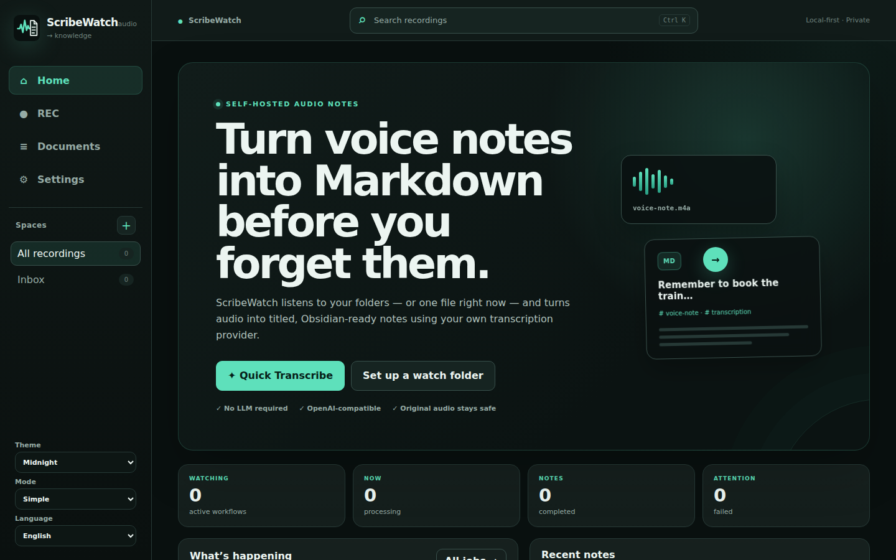
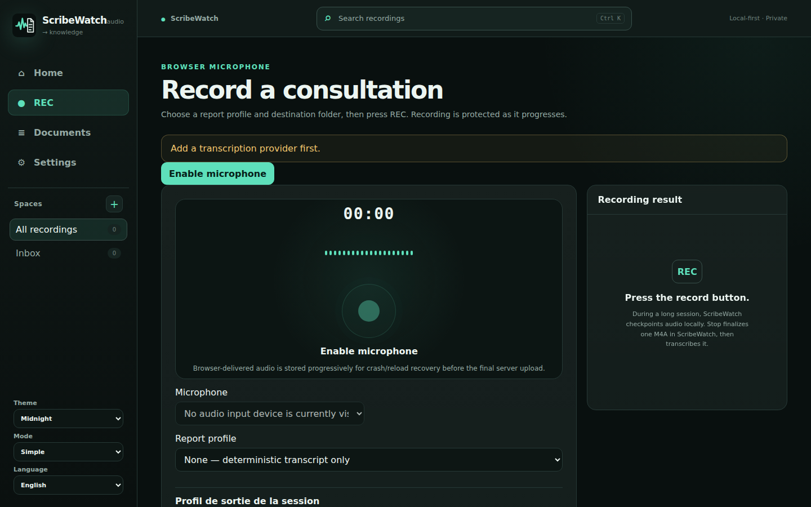
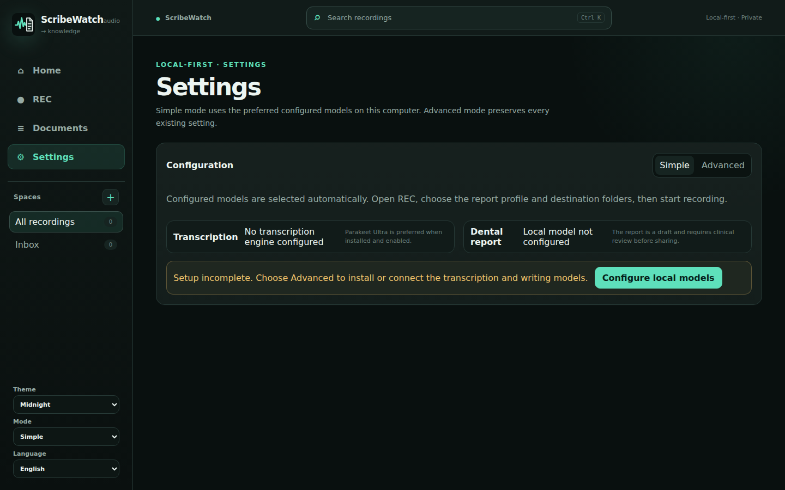
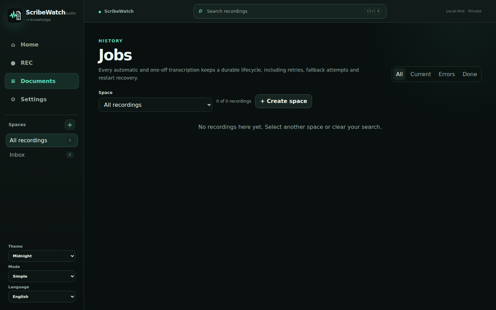
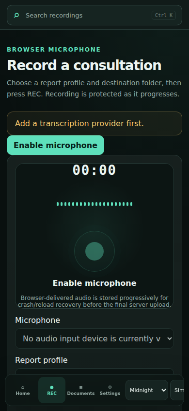

<p align="center">
  
</p>

<h1 align="center">ScribeWatch</h1>

<p align="center">
  <strong>Record. Transcribe. Structure. Keep control.</strong><br>
  Local-first recording, transcription and structured documents for Windows, macOS, Linux and self-hosted workflows.
</p>

<p align="center">
  <a href="https://github.com/GodsQuantum/ScribeWatch/actions/workflows/ci.yml"></a>
  <a href="LICENSE"></a>
  
  
  
  
</p>

<p align="center">🇫🇷 <a href="README.fr.md">README en français</a> · <a href="README.zh-CN.md">简体中文</a></p>

---

ScribeWatch turns recordings into **clean, titled Markdown notes** using your own OpenAI-compatible speech-to-text provider. Drop one voice memo into **Quick Transcribe**, record directly in **Live Recorder**, or point a **Workflow** at a folder and let ScribeWatch handle new recordings automatically.

The transcript remains canonical and deterministic. When a workflow needs more structure, an optional OpenAI-compatible LLM can add a reusable meeting, consultation, brainstorm or custom structured view **without replacing the original transcript**.

It is especially useful as a **voice notes → Obsidian** bridge, but nothing is Obsidian-specific: any Markdown folder works.

<p align="center">
  
</p>

## Download ScribeWatch v0.6.2

**Source code: v0.6.4.** The installer links below intentionally remain on the last **published and verified release, v0.6.2**, while v0.6.4 runs its release checks. The interface screenshots are from an isolated live v0.6.4 instance; the layout is unchanged.


**[Latest official release](https://github.com/GodsQuantum/ScribeWatch/releases/latest)** · [Source code](https://github.com/GodsQuantum/ScribeWatch) · [Verify SHA-256 checksums](https://github.com/GodsQuantum/ScribeWatch/releases/tag/v0.6.2)

| Platform | Edition | Download | What is included |
|---|---|---|---|
| **Windows 11 x64** | **Full standalone — recommended** | [Download full installer](https://github.com/GodsQuantum/ScribeWatch/releases/download/v0.6.2/ScribeWatch-0.6.2-windows-amd64-standalone-setup.exe) | ScribeWatch, built-in local transcription and LLM engines, automatic first-launch model downloads |
| Windows x64 | Lightweight | [Download installer](https://github.com/GodsQuantum/ScribeWatch/releases/download/v0.6.2/ScribeWatch-0.6.2-windows-amd64-setup.exe) | Desktop app; connect an existing STT/LLM provider |
| macOS Apple Silicon | Lightweight | [Download ARM64 DMG](https://github.com/GodsQuantum/ScribeWatch/releases/download/v0.6.2/ScribeWatch-0.6.2-darwin-arm64.dmg) | Desktop app; configure compatible engines separately |
| macOS Intel | Lightweight | [Download Intel DMG](https://github.com/GodsQuantum/ScribeWatch/releases/download/v0.6.2/ScribeWatch-0.6.2-darwin-amd64.dmg) | Desktop app; configure compatible engines separately |
| Linux x86-64 | AppImage | [Download AppImage](https://github.com/GodsQuantum/ScribeWatch/releases/download/v0.6.2/ScribeWatch-0.6.2-x86_64.AppImage) | Desktop app; configure compatible engines separately |
| Linux ARM64 | AppImage | [Download AppImage](https://github.com/GodsQuantum/ScribeWatch/releases/download/v0.6.2/ScribeWatch-0.6.2-aarch64.AppImage) | Desktop app; configure compatible engines separately |

**Windows full standalone:** On a clean install, the app prepares Parakeet Ultra transcription, Qwen3.5-4B Q4_K_M structured-document generation and five report profiles (dental consultation, medical consultation, meeting, brainstorm, structured note). The first download needs internet and several GB of storage. Once both models are ready, processing uses local engines; REC indicates readiness. Enter the document details, choose the destination, grant microphone permission, press **REC**, then **Stop** to generate and export your document/PDF. Adaptation to the host's GPU and memory is automatic within supported runtime capabilities.

The full Windows bundle and its startup have passed packaged-install CI. **A first-install physical microphone/GPU and full clinical-quality E2E test on every possible PC is not yet certified.** Other OS editions and Docker do not currently include this same zero-configuration local AI package. Clinical documents are drafts requiring practitioner review.

**Coming in the next packaged release (not in the downloadable v0.6.2 installers):** every Windows, macOS and Linux desktop edition embeds its own verified Pandoc 3.14, Typst 0.15.1 and Noto Sans CJK font assets. **MD, TXT, HTML, DOCX, ODT and PDF** exports then work without globally installed Pandoc, WeasyPrint, LaTeX, Python or LibreOffice. The browser PDF route was already self-contained; the server API will now prefer the bundled renderer. Model weights still require an initial download.

Desktop binaries are not guaranteed to be code-signed or Apple-notarized; verify the matching checksum and the release notes before running them.

## The current interface

**Home** provides an overview and access to quick transcription and watched folders. **REC** is the recording workspace. **Documents** contains completed jobs and exports. **Settings** contains transcription providers, local/external AI engines, structure profiles and advanced options. The interface supports **English, French and Simplified Chinese**, five themes, and **Simple / Advanced** modes.

<p align="center"></p>

Captures are from an isolated demonstration instance running the release itself, not mockups and not patient material.

## Why ScribeWatch?

- **Voice notes become useful files** — readable `.md`, not another pile of forgotten recordings.
- **Quick Transcribe** — drag in one audio file and get Markdown back immediately.
- **Live Recorder** — record a browser microphone with progressive OPFS checkpoints, crash/reload recovery, **Continue** after interruption, playback/scrubbing of recovered audio, and optional final-audio retention on the server or client computer.
- **Watch folders** — automatically process new recordings from a server, NAS or mounted sync folder.
- **Content-based audio ingest** — FFprobe detects decodable audio streams instead of trusting a filename extension; FFmpeg normalizes every source before STT.
- **Optional AI structure profiles** — reusable meeting, medical-documentation, brainstorm, interview and custom prompts can add a structured view after transcription.
- **Multi-format export** — export completed Quick, Live or historical jobs directly as MD, TXT, HTML, DOCX, ODT or PDF.
- **Multilingual interface** — switch persistently between English, French and Simplified Chinese.
- **Obsidian-friendly by default** — clean filenames, H1 titles, YAML properties and tags.
- **Bring your own transcription engine** — works with OpenAI-compatible STT endpoints such as Speaches/Whisper services.
- **Resilient transcription chains** — mix providers and models in any order. If one route fails, ScribeWatch automatically tries the next — even another model from the same provider.
- **No LLM required** — titles and Markdown formatting are deterministic; the transcript stays authoritative.
- **Readable deterministic paragraphs** — Unicode sentence boundaries (UAX #29) plus fixed size limits make long transcripts readable without paraphrasing, summarizing or inventing headings.
- **Safe publication** — Markdown is written before workflow audio is archived, and existing notes are never silently overwritten.
- **Small self-hosted stack** — Rust/Axum backend, SvelteKit UI, SQLite state, one container.

## Three ways to use it

| | **Quick Transcribe** | **Live Recorder** | **Watch folders** |
|---|---|---|---|
| Best for | One existing recording | Record now from a microphone | Recurring / automatic capture |
| Input | Browser upload or server file | Browser microphone | Watched server/NAS folder |
| Output | Server folder or your computer | Server folder or your computer | Markdown folder |
| Original audio | Never moved | Browser checkpoints survive interruption; accepted server source is retained 24 h for retry; optional permanent M4A copy | Archived only after Markdown succeeds |
| AI structure | Optional | Optional | Optional |
| Typical use | “I just recorded an idea” | Meeting / consultation / brainstorm | Phone/sync folder → Obsidian automatically |

<p align="center">
  
  
</p>

## Provider + model fallbacks

Every transcription route is an explicit **provider + model** pair. ScribeWatch discovers the models exposed by each configured provider, so you choose the exact chain — including multiple models from the same provider.

```text
Speaches / whisper-large-v3
          ↓ failed
Speaches / distil-whisper-large-v3
          ↓ failed
OpenAI / gpt-4o-transcribe
          ↓
Markdown
```

Each provider has an enforced request timeout, while each route can optionally define an independent, potentially shorter fallback timeout (`Never`, 10/30/60 minutes or custom). Connection failures, provider timeouts/errors, rate limits and invalid responses can fall through; explicit user cancellation stops the whole chain. Jobs keep the attempt history and record the provider/model that actually succeeded.

## Self-host with Docker

For the **Docker edition** only: Docker Engine + Compose and an existing OpenAI-compatible transcription endpoint. The Windows full standalone edition above does not need Docker.

```bash
git clone https://github.com/GodsQuantum/ScribeWatch.git
cd ScribeWatch
cp .env.example .env
cp compose.example.yaml compose.yaml
mkdir -p config data watch notes archive

docker compose pull
docker compose up -d
```

Open **http://127.0.0.1:3000**, then:

> Live microphone capture is a browser secure-context feature. `localhost` / `127.0.0.1` is accepted for local use; remote/LAN clients should normally open ScribeWatch through **HTTPS**. If a workstation can reach the NAS only through plain HTTP, open **Live → Local microphone mode…** and generate a preconfigured installer for **Linux, Windows or macOS**. The helper installs only a localhost-bound TCP proxy to the existing NAS instance — never a second ScribeWatch — then opens `http://127.0.0.1:3052`. Linux uses a per-user systemd socket, Windows uses `netsh interface portproxy`, and macOS uses a per-user LaunchAgent. Every generated installer also supports `--uninstall`. Browsers cannot silently execute system installers, so the downloaded helper must be run once by the user/OS. The standalone Linux fallback is `bash scripts/install-local-loopback-linux.sh <NAS-host-or-IP:HTTP-port>`.

### Long LIVE recordings and crash recovery

During LIVE capture, ScribeWatch writes each browser-delivered MediaRecorder slice to the browser's **Origin Private File System (OPFS)** instead of accumulating the entire session in JavaScript memory. It requests persistent browser storage when available, forces an extra checkpoint when the page becomes hidden, and uses a Screen Wake Lock when supported.

If the tab/browser reloads or crashes, the next visit detects the unfinished session. You can **play and scrub the last saved segment**, jump to the **last 30 seconds**, then choose **Continue**. Continue starts a new MediaRecorder segment under the same logical session; ScribeWatch records the estimated interruption gap and never fabricates silence to hide missing audio.

At Stop/finalization, completed segments are streamed to the ScribeWatch backend and FFmpeg produces one canonical mono AAC/M4A in manifest order. The final audio can be kept in **no permanent copy**, a chosen **server folder**, or a chosen **folder on this computer**. Client-side recovery data is not deleted until the server has durably accepted the recording and any requested client copy has completed.

Accepted Quick/LIVE sources are kept for **24 hours by default**, including Error/Interrupted/Cancelled jobs, so Retry after a transcription failure or ScribeWatch restart still has a real source file. This feature improves recording-loss resilience; it does **not** by itself make ScribeWatch a certified medical-record system or establish healthcare/regulatory compliance.

1. Add your transcription endpoint under **STT**.
2. Use **Quick** for an existing recording, **Live** for a browser microphone, or create a **Workflow**.
3. Optional: add an OpenAI-compatible LLM under **AI Profiles** and connect one or more structure profiles.
4. For automation, choose **Watch folder → Markdown folder → Audio archive**. Watch folders are recursive.
5. Leave **Markdown folder** empty to publish each note beside its source audio, even in nested subfolders. **Audio archive** may live inside the Watch folder; that entire archive subtree is always excluded from watching.

> By default ScribeWatch binds locally. If you expose it on a trusted LAN/VPN, change `SCRIBEWATCH_BIND_HOST` and use your normal firewall or authenticated reverse proxy policy.

## Built for Obsidian — not locked to it

A transcript can become a note like this:

```markdown
---
title: "Remember to book the train tomorrow"
created: 2026-09-16T08:42:00Z
tags:
  - voice-note
  - transcription
  - scribewatch
source: "Recording 42.m4a"
provider: "Local Speaches"
model: "whisper-large-v3"
language: "en"
---

# Remember to book the train tomorrow

Remember to book the train tomorrow...
```

ScribeWatch derives the title from the transcript, keeps Unicode-readable filenames, deduplicates tags and handles filename collisions as `Title (2).md`, `Title (3).md`, etc.

### Deterministic transcript formatting

By default ScribeWatch formats the transcript body into readable paragraphs **without an LLM**. Unicode sentence boundaries follow **Unicode Standard Annex #29** through Rust's `unicode-segmentation` crate; sentences are grouped with fixed sentence/word/character limits; punctuation-free STT falls back to fixed word-count blocks; and existing blank-line boundaries are preserved. **No word is rewritten, summarized or semantically reclassified.**

Disable **Readable deterministic paragraphs** in Quick Transcribe or a Workflow when you want the provider transcript body exactly as returned.

### Optional AI structure profiles

LLM processing is a **second, optional layer**. ScribeWatch always finishes STT first and keeps that transcript intact. When a structure profile is selected, the resulting note contains both:

```text
Audio → FFmpeg normalization → STT → canonical transcript
                                      ├─ deterministic Markdown
                                      └─ optional structure profile → Structured notes
```

Built-in profiles cover general structured notes, meetings/phone calls, conservative medical documentation, dedicated general-medicine consultation drafts, dedicated dental consultation drafts, marketing brainstorms and interviews/research. Clinical profiles are documentation-only: they preserve uncertainty, distinguish reported from observed/stated information, and surface clinically material ambiguities for practitioner verification instead of inventing missing findings or diagnoses. They can be connected to any OpenAI-compatible chat-completions endpoint and edited for your deployment; custom profiles can be created from scratch.

Long transcripts are processed in bounded evidence chunks before final synthesis. The system prompt treats transcript text as untrusted data, forbids invented facts, and requires uncertainty to remain explicit. If the LLM fails, **the job still succeeds with the canonical transcript** and records the structuring error separately.

<p align="center">
  
</p>

## Workflow model

```text
Voice recorder / sync / NAS
            │
            ▼
       Watch folder
            │
       transcription
            │
            ▼
      Markdown folder ─────► Obsidian / notes / knowledge base
            │
     publish succeeds
            │
            ▼
       Audio archive
```

Workflow audio is **never archived before Markdown publication succeeds**. Watch folders are recursive, and both native filesystem events and periodic reconciliation cover nested subfolders. When **Markdown folder** is empty, the note is published in the exact directory containing the detected source audio. The configured **Audio archive** subtree is ignored before audio probing, so an archive such as `Watch/Vocaux` can safely live inside the watched tree without being re-ingested.

## Safety by design

- Provider API keys stay server-side and are never returned to the browser.
- Server browsing is restricted to explicit allowed roots and rejects symlink escapes.
- Browser uploads are bounded while streaming; retryable Quick/LIVE sources are retained for the configured source-retention window instead of being deleted on transcription failure.
- Quick Transcribe never moves or deletes the original source file.
- Existing Markdown is never silently overwritten.
- Interrupted work is recorded explicitly after restart instead of pretending it completed.
- LLM structure is best-effort: it can never replace or invalidate a successful canonical transcript.
- Document export neutralizes Markdown image targets and disables raw HTML before Pandoc conversion.
- The example container runs non-root with a read-only root filesystem, dropped capabilities and `no-new-privileges`.

See [`SECURITY.md`](.github/SECURITY.md).

## Configuration

| Variable | Default | Purpose |
|---|---|---|
| `SCRIBEWATCH_HOST` | `0.0.0.0` | HTTP bind address inside the container |
| `SCRIBEWATCH_PORT` | `3000` | HTTP port |
| `SCRIBEWATCH_CONFIG_DIR` | `/config` | SQLite/config directory |
| `SCRIBEWATCH_DATA_DIR` | `/data` | Quick upload/result staging |
| `SCRIBEWATCH_ALLOWED_ROOTS` | required | Colon-separated server roots ScribeWatch may access |
| `SCRIBEWATCH_SCAN_SECONDS` | `5` | Watch-folder reconciliation cadence |
| `SCRIBEWATCH_FILE_STABILITY_MS` | `2000` | Stable-size/mtime window before ingest |
| `SCRIBEWATCH_MAX_TRANSCRIPTION_JOBS` | `2` | Concurrent transcription jobs |
| `SCRIBEWATCH_MAX_UPLOAD_BYTES` | `2147483648` | Maximum streamed browser upload |
| `SCRIBEWATCH_QUICK_RESULT_RETENTION_HOURS` | `24` | Client-result retention window |
| `SCRIBEWATCH_QUICK_SOURCE_RETENTION_HOURS` | `24` | Retryable Quick/LIVE source and stale LIVE staging retention window |
| `SCRIBEWATCH_NORMALIZED_AUDIO_FORMAT` | `wav` | Normalized STT payload: `wav` for maximum compatibility or lossless `flac` to reduce transfer/storage size |
| `SCRIBEWATCH_FFMPEG_THREADS` | `1` | FFmpeg normalization thread cap per job; keep low when multiple transcription jobs run concurrently |

Audio ingest is **content-based, not extension-based**. Stable Watch files and Quick uploads are probed with FFprobe; any file containing an audio stream that the bundled FFmpeg can decode is accepted, then normalized to mono 16 kHz audio before STT. WAV is the compatibility default; lossless FLAC is available for deployments that want a smaller normalized payload.

## Client-computer folders

Browsers cannot continuously watch arbitrary folders on another computer. ScribeWatch keeps that boundary explicit:

- local audio enters through drag-and-drop, the browser file picker, or Live Recorder microphone capture;
- completed Markdown can be written directly to a local folder when the browser supports the File System Access API in a secure context;
- LIVE final audio can likewise be saved to a chosen client folder after ScribeWatch finalizes the canonical M4A; the directory handle stays browser-side in IndexedDB/OPFS metadata;
- otherwise ScribeWatch downloads the file normally.

No browser directory handle is sent to or stored by the ScribeWatch server.

## Stack & development

**Backend:** Rust 1.98 · Axum · Tokio · SQLite · notify
**Frontend:** Svelte 5 · SvelteKit 2 · TypeScript
**Media / exports:** FFmpeg + FFprobe · Pandoc · WeasyPrint

```bash
cargo fmt --all -- --check
cargo clippy --locked --all-targets --all-features -- -D warnings
cargo test --locked --all-targets
cd frontend && npm ci && npm test && npm run check && npm run build
```

Deterministic end-to-end check:

```bash
bash scripts/e2e-v02.sh
```

## API highlights

- `POST /api/v1/quick/upload` — streamed browser upload
- `POST /api/v1/quick/server` — allowed server-side audio file
- `POST /api/v1/live/upload` — streamed multi-segment LIVE finalization with idempotent session acceptance
- `GET /api/v1/jobs/{id}/audio` — retained canonical M4A for accepted LIVE jobs
- `GET /api/v1/jobs/{id}/markdown` — completed client-output Markdown
- `GET /api/v1/jobs/{id}/export/{format}` — MD/TXT/HTML/DOCX/ODT/PDF export
- `GET|POST /api/v1/workflows` — watch-folder automation
- `GET|POST /api/v1/providers` — OpenAI-compatible transcription providers
- `GET|POST /api/v1/llm-providers` — optional OpenAI-compatible LLM providers
- `GET|POST /api/v1/structure-profiles` — reusable LLM structure profiles
- `GET /api/v1/jobs`, `GET /api/v1/events` — history and live state
- `GET /api/v1/health`, `GET /api/v1/ready` — health/readiness

## Hardware-aware safe performance starter

**Downloads:** [All official ScribeWatch v0.6.2 installers](https://github.com/GodsQuantum/ScribeWatch/releases/tag/v0.6.2). Builds may be unsigned or not Apple-notarized. Check SHA256 before trusting a binary.

~~~bash
python3 scripts/auto-tune.py           # read-only CPU and RAM detection
python3 scripts/auto-tune.py --env     # suggested settings to review for .env
~~~

- On a small host with 2–4 effective threads or under 8 GiB, start with a single transcription.
- On a generic 16-thread, 32 GiB host, start with 2 concurrent jobs, 1 FFmpeg decode thread, 5-second scan interval and 2-second file stability. Slow NFS mounts may require longer stability.
- Pair an actually available Speaches /v1 or OpenAI-compatible provider from Settings. Test a real audio file and the Markdown/Obsidian output, then check retries, archive safety and provider fallback before enabling a watched folder.
- A remote NAS container cannot automatically access client-side microphones or files. Enable client folder access or explicitly authorized paths.
- This detector does **not** modify files, existing mounts, application data or running services. For remote access prefer an authenticated HTTPS reverse proxy over exposing the default loopback-bound Docker port.

### Optional local text LLM (native desktop)

In **AI Profiles → Local AI engine discovery**, the desktop build checks only
known localhost API ports for Lemonade Server (13305), LM Studio (1234), Ollama
(11434) and llama.cpp/Llama-Windows (8080). Click a detected engine to prefill
the OpenAI-compatible chat endpoint and choose a locally available model.
For a custom endpoint, provide its chat-completions URL and optional API key,
then use **Find models from URL** (desktop) or **Discover models** after saving
a provider (desktop or server). No clinical transcript is sent during discovery.

On Windows, **Install Lemonade (WinGet)** explicitly asks permission before
using the official AMD.LemonadeServer package; alternatively, the official MSI
download is linked. This optional manual path does not apply to the full Windows standalone bundle, which provisions its bundled engines and downloads its default models automatically.
After Lemonade is running, **Install selected model** offers a lightweight
official Liquid LFM3-1.7B Q4_K_M GGUF or the larger Qwen3.5-4B Q4_K_M,
using Lemonade's own native model-download API and persistent job manager.
Click **Check progress** to see download status; rescan when complete.
Model architecture support depends on the installed backend version.
Small models are not automatically clinically accurate: review and correct
all generated reports, and keep the original transcript.

Security boundaries: the install/pull APIs exist only when the native desktop
launcher marks its loopback-bound backend. They require a matching same-origin
browser request, accept only allowlisted model IDs/official WinGet package IDs,
and cannot execute caller-supplied commands or fetch arbitrary installation
scripts. Normal server/Docker deployments do not gain host-install privileges.

### Product roadmap — one UI across every platform

The shared desktop/browser theme and recording-space experience, and the
remaining macOS/Linux full-standalone, systray, model/GPU and trusted-signing
certification gates, are tracked in
[docs/ROADMAP_DESKTOP_PORTABILITY.md](docs/ROADMAP_DESKTOP_PORTABILITY.md).
Existing workflows, microphone recovery, recordings and exports are preserved.

## Contributing

Issues and pull requests are welcome. See [`CONTRIBUTING.md`](.github/CONTRIBUTING.md) and [`CODE_OF_CONDUCT.md`](.github/CODE_OF_CONDUCT.md).

If ScribeWatch earns a place in your stack, a ⭐ helps other voice-note and Obsidian users find it.

## License

[MIT](LICENSE)

Maintained by [Arezki Chougar](https://arezkichougar.com) · [MIT](LICENSE).

**Transcription engine provenance:** the full Windows installer ships a portable build of **[Speaches Reloaded](https://github.com/GodsQuantum/Speaches-Reloaded)** (its historical executable name is still `Cloud9-Speaches`), not just `transcribe.cpp`. The portable package includes the Speaches API, executors and dependencies; `transcribe.cpp` is one engine option.
