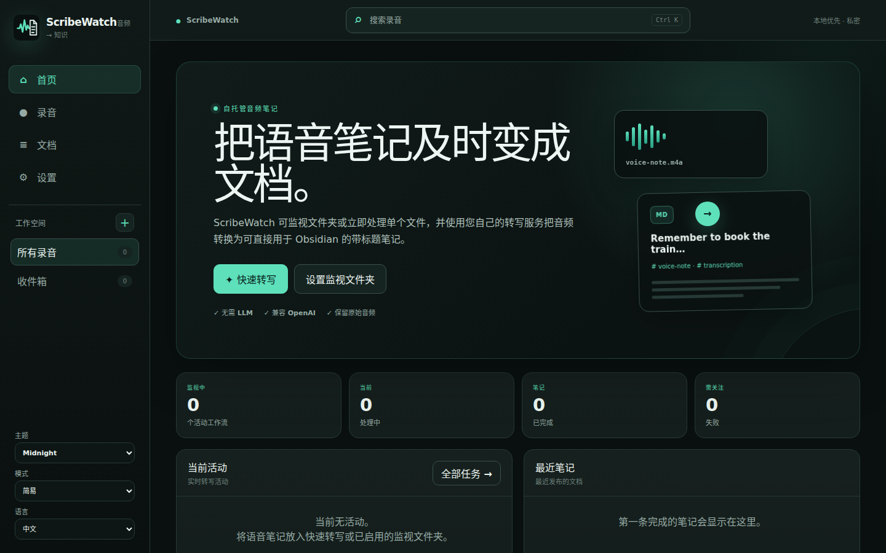
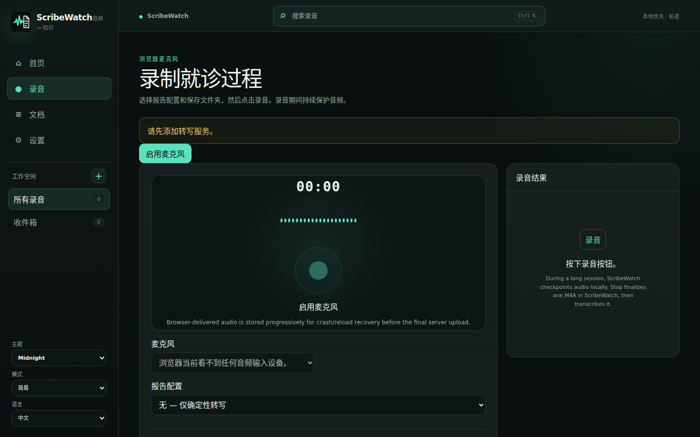
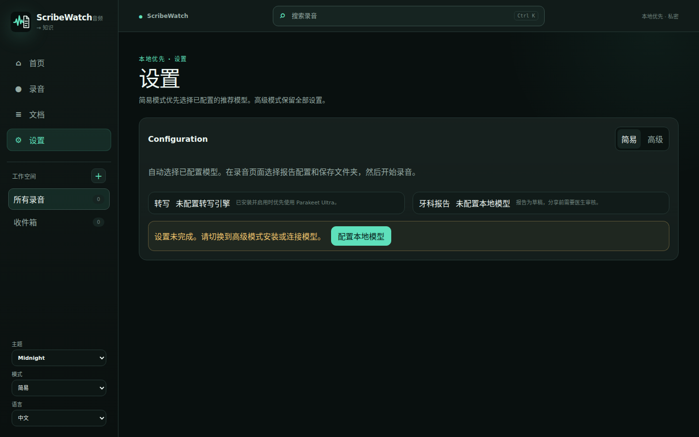
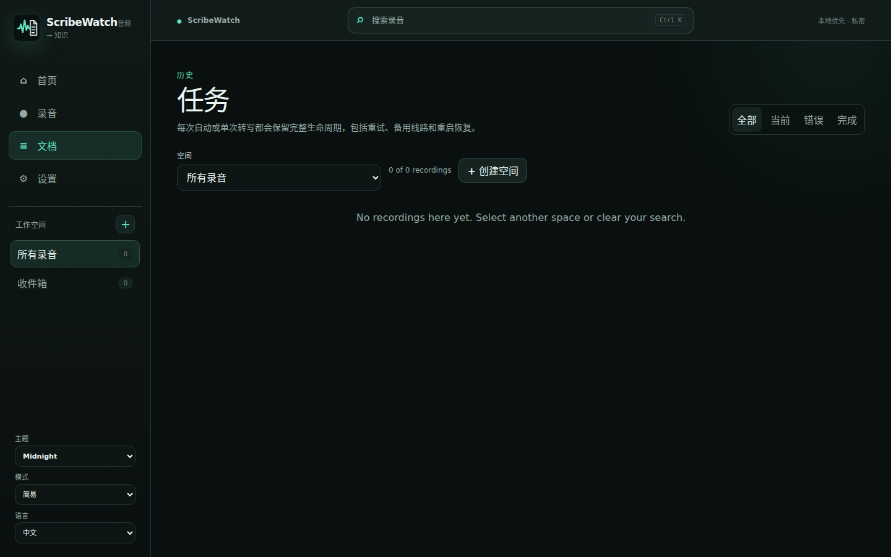

<h1 align="center">ScribeWatch</h1>

<strong>从录音到可用的文档，数据由您掌控。</strong> 开源、隐私优先的录音、转录和结构化笔记工具。

<a href="README.md">English</a> · <a href="README.fr.md">Français</a> · <strong>简体中文</strong>

<a href="https://github.com/GodsQuantum/ScribeWatch/releases/latest">下载最新版本</a> · <a href="https://github.com/GodsQuantum/ScribeWatch/issues">反馈问题</a> · <a href="https://arezkichougar.com">作者 Arezki Chougar</a>

## ScribeWatch v0.6.4 下载

**[官方网站](https://scribewatch.arezkichougar.com/)** · **[最新 GitHub 正式版本](https://github.com/GodsQuantum/ScribeWatch/releases/latest)** · [SHA-256 校验](https://github.com/GodsQuantum/ScribeWatch/releases/tag/v0.6.4) · [源代码](https://github.com/GodsQuantum/ScribeWatch)

**新用户请选择完整版本。** 完整安装包包含本地语音转写和文档整理引擎；首次启动需联网下载模型，此后使用本地模型时无需将录音和文档发送至云端。

| 系统 | 完整本地版本 | 安装包 |
|---|---|---|
| **Windows 11 x64** | 推荐 | [Windows 完整安装程序](https://github.com/GodsQuantum/ScribeWatch/releases/download/v0.6.4/ScribeWatch-0.6.4-windows-amd64-standalone-setup.exe) |
| macOS Apple Silicon | 本地模型 | [Apple Silicon DMG](https://github.com/GodsQuantum/ScribeWatch/releases/download/v0.6.4/ScribeWatch-0.6.4-darwin-arm64-standalone.dmg) |
| macOS Intel | 本地模型 | [Intel DMG](https://github.com/GodsQuantum/ScribeWatch/releases/download/v0.6.4/ScribeWatch-0.6.4-darwin-amd64-standalone.dmg) |
| Linux x86-64 | 本地模型 | [完整 AppImage](https://github.com/GodsQuantum/ScribeWatch/releases/download/v0.6.4/ScribeWatch-0.6.4-x86_64-standalone.AppImage) · [Debian/Ubuntu .deb](https://github.com/GodsQuantum/ScribeWatch/releases/download/v0.6.4/scribewatch_0.6.4_amd64.deb) |
| Linux ARM64 | 本地模型 | [完整 AppImage](https://github.com/GodsQuantum/ScribeWatch/releases/download/v0.6.4/ScribeWatch-0.6.4-aarch64-standalone.AppImage) · [Debian/Ubuntu .deb](https://github.com/GodsQuantum/ScribeWatch/releases/download/v0.6.4/scribewatch_0.6.4_arm64.deb) |

**使用方法：** 安装后首次联网下载数 GB 模型，选择文档类型，录音或导入音频，然后导出 PDF、Word、ODT、HTML、TXT 或 Markdown。完整版本内置 Pandoc 3.14、Typst 0.15.1 及字体，无需另行安装。普通 64 位处理器也可使用，兼容显卡会加快速度；**结构化报告建议 16 GB 内存**，这不是所有设备的保证最低配置。

**高级用户：** [GitHub 正式版本](https://github.com/GodsQuantum/ScribeWatch/releases/tag/v0.6.4) 还提供各平台轻量版。轻量版**不包含本地转写和文档模型**，需要事先配置兼容服务，不适合新用户。

安装程序通过多平台 CI 测试，但不同实体麦克风、显卡以及医疗报告质量仍需要单独验证。医疗内容必须由专业人员审阅。选择外部服务时，适用该服务的隐私政策。安装包可能未经过正式代码签名或 Apple 公证，请核对 SHA-256。

## v0.6.4 当前界面

**首页（Home）**：总览、快速转录、监控文件夹入口。**录音（REC）**：浏览器麦克风录制、断线恢复。**文档（Documents）**：历史任务、文档和导出。**设置（Settings）**：转录和 LLM 服务、模型、报告模板、高级参数。支持英语、法语、简体中文、五种主题及简单/高级模式。

所有截图都来自隔离的真实应用演示环境，不含私人或患者信息。

## 功能与数据安全

- **录音：** 浏览器录制时通过 OPFS 分片保存，支持页面重载后恢复、继续和保存最终音频。
- **快速转录：** 上传音频、选择服务器上允许访问的文件或使用监控文件夹；FFprobe/FFmpeg 对输入音频进行解析和标准化。
- **原始转录：** 作为可靠来源保留；确定性段落格式化不会改写内容；支持 Obsidian 友好的 Markdown 和 YAML 属性。
- **可选结构化 AI：** 根据会议、会诊等模板整理笔记，不覆盖原始文字；长转录采用分段处理；LLM 失败不会删除已完成的原始转录。
- **所有文档模板均受保护：** 整段内容覆盖、依据原文核对事实及按设备内存自适应的处理策略由软件引擎统一提供，未来新建的自定义模板也自动适用；模板只决定整理重点和文档形式。
- **导出：** MD、TXT、HTML、DOCX、ODT、PDF。工作流只会在 Markdown 写入成功后归档音频。
- **模型回退：** 兼容 OpenAI 风格的 STT 接口，可按顺序配置多个提供商和模型。
- **隐私：** 自托管安装可控制数据去向；使用外部 API 时由所选提供商处理传输的内容。请勿把患者数据、密钥或私有文档提交至公开 Issue。

## 使用 Docker 自托管

Docker 版本为轻量服务器，**不会自动安装 Windows 完整版自带的本地 Parakeet Ultra 和 Qwen 4B 模型**。需要自己提供兼容的 STT 服务，可选配置 LLM 服务。

前提：Docker Engine、Docker Compose 以及可访问的转录 API。

~~~bash
git clone https://github.com/GodsQuantum/ScribeWatch.git
cd ScribeWatch
cp .env.example .env
cp compose.example.yaml compose.yaml
mkdir -p config data watch notes archive
docker compose pull
docker compose up -d
~~~

浏览器打开 http://127.0.0.1:3000。对网络中的其他设备使用录音麦克风，通常需要 HTTPS 安全上下文；Docker 无法自动访问客户端设备的麦克风和文件夹。按实际需要设置允许访问的服务器根目录，并通过经过认证的代理或 VPN 提供远程访问。

## 硬件配置与高级选项

Docker 的只读调优脚本会读取 CPU 和内存，并提出可审查的并行度建议；它不会修改配置或磁盘。

~~~bash
python3 scripts/auto-tune.py
python3 scripts/auto-tune.py --env
~~~

推荐先测试真实音频，核对输出位置、录音恢复、转录提供商回退、原文保留和归档，再启用自动工作流。请阅读 [English technical guide](README.md)、[Français](README.fr.md)、[desktop packaging notes](packaging/desktop/README.md)、[roadmap](docs/ROADMAP_DESKTOP_PORTABILITY.md)。

## 开发与贡献

后端采用 Rust/Axum、SQLite；前端采用 SvelteKit，使用 FFmpeg/FFprobe 和文档导出工具。欢迎通过 [GitHub Issues](https://github.com/GodsQuantum/ScribeWatch/issues) 报告可重现的问题，也欢迎提交 Pull Request；请遵守 [CONTRIBUTING](.github/CONTRIBUTING.md) 与 [SECURITY](.github/SECURITY.md)。源码采用 [MIT 许可证](LICENSE)，作者 [Arezki Chougar](https://arezkichougar.com)。

**转录引擎来源：** Windows 完整安装包含 **[Speaches Reloaded](https://github.com/GodsQuantum/Speaches-Reloaded)** 原生可执行程序与完整依赖，不只是 `transcribe.cpp`；旧版可执行文件名仍为 `Cloud9-Speaches`。
